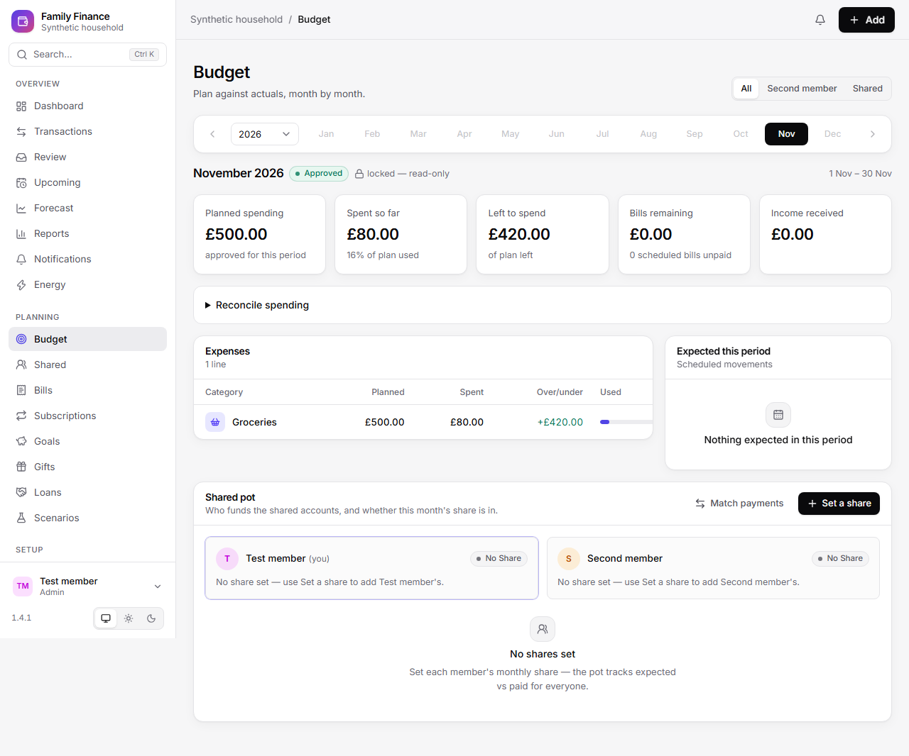
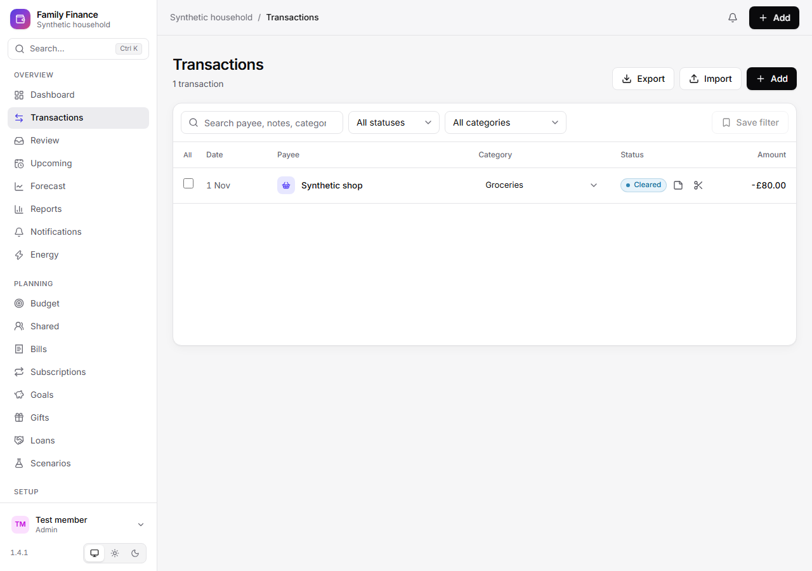
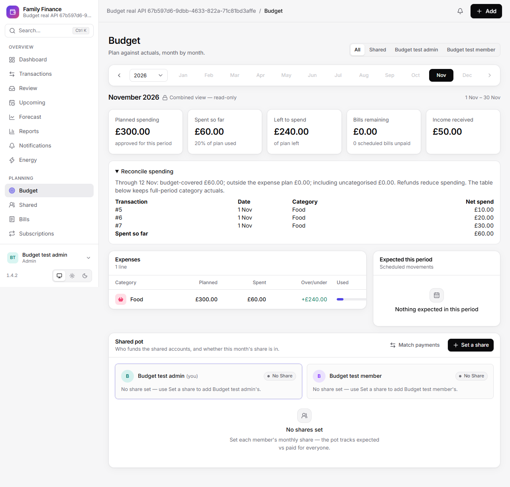
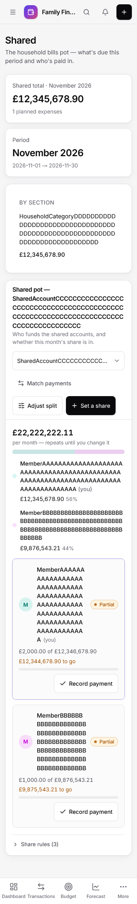
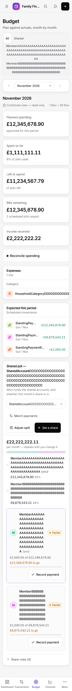
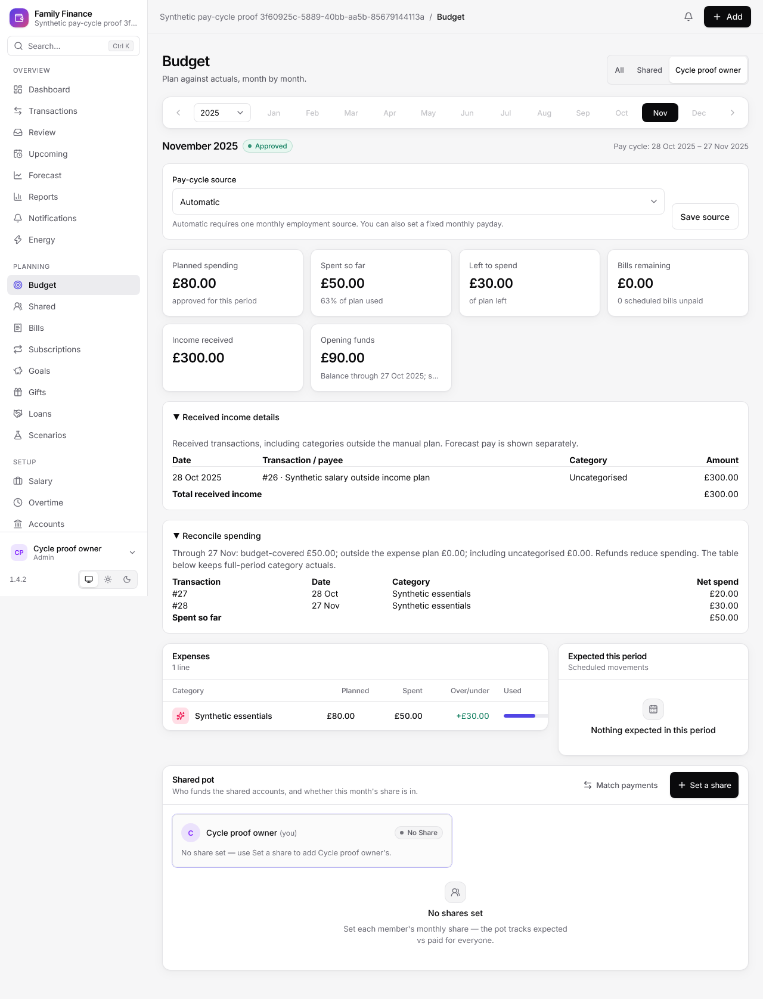
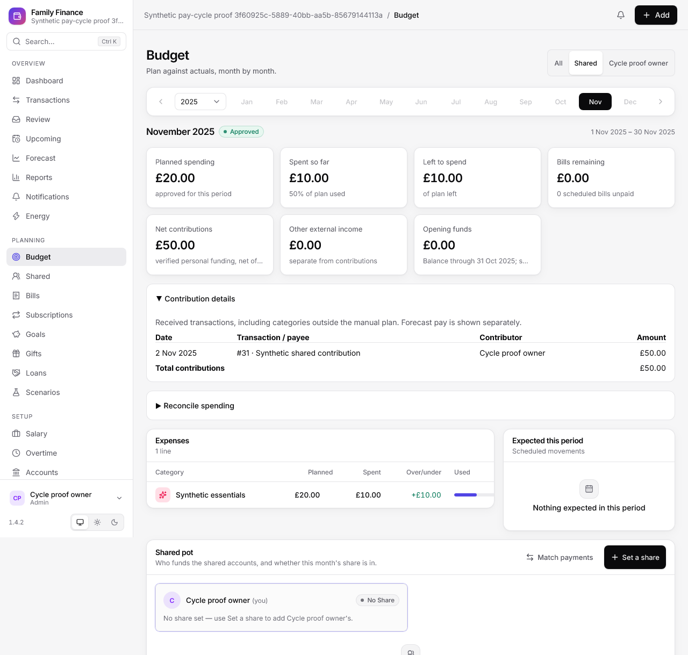

# Historical regression review

## Dashboard preference recovery (#492)

Role-restricted widgets remain unmounted while member identity/role is unresolved,
even when a retained tab draft supplies a layout immediately. Only explicit
standalone mode or an allowed resolved role can mount those widgets.

Dashboard validates local and remote layout shapes before using them. Missing,
malformed and obsolete fields recover without throwing or automatically writing
defaults to the profile. Recognized widget order and explicitly hidden widgets,
including a deliberately all-hidden layout, remain respected.

Standalone preferences wait for member identity resolution. Browser snapshots
and unsaved tab drafts are scoped to household and member; ingress uses the
trusted `auth/me` member, with the session mount as a startup boundary. A valid
remote layout wins over a browser snapshot. Failed PUTs keep an explicitly
unsaved draft through route navigation and reload, with Retry saving layout and
Revert layout actions. A successful response is required before showing saved.
The tab draft disappears when the tab's session storage is cleared.
If tab storage is blocked, the dashboard remains usable and a failed save
explicitly warns that the draft could not be retained across navigation.

Customisation controls are disabled while a PUT is pending. Active writes share
a per-resource lock across route remounts and are removed from the registry on
completion; late replies cannot replace another member's layout. This prevents
overlapping writes initiated by this document. Concurrent edits from independent
tabs/devices, or an old server request continuing after a complete page reload,
still follow the existing last-write-wins endpoint contract; this change adds no
server revision protocol. Retry resends the same idempotent layout PUT.

Component regressions cover actual Dashboard mounts, malformed shapes, hidden
intent, failed saves, retry/revert, resource changes, delayed replies and pending
remounts. The production-bundle browser fixture uses only synthetic intercepted
APIs on an isolated static server; it verifies malformed storage boot and a
rejected save through Transactions, Bills, Budget, Dashboard and reload before a
successful retry. It does not establish released Home Assistant/iOS acceptance
for #414 or #460.

This change follows the v1.4.1 reports and the historical issue audit.
Tests use synthetic data. Production data, bank credentials and snapshots
are excluded from the repository.

## Legacy refund correction capacity

Refund capacity resolves each correction family to one live payment. A live
explicit purchase link remains authoritative after amount, date or account
edits. Pre-upgrade NULL links inherit only through financially equivalent void
predecessors to the nearest explicit purchase link. Linked descendants count
once; terminal void refunds release capacity. Cyclic, ambiguous or unprovable
legacy families require manual review and raise the existing refund conflict.
Automatic refund linking skips such candidates and continues processing valid
payments. These reads do not repair stored links or rewrite protected history.

## Automatic reconciliation of legacy correction cycles

Automatic reconciliation excludes cyclic correction families before scoring,
using the same ancestry filter as automatic transfer matching. Self-cycles and
multi-row cycles leave their stored rows untouched while unrelated valid
payments still settle, including through the post-sync workflow. Explicit
confirmation retains the settlement writer's conflict rejection.

## Weekly overtime (#487)

Coverage includes derived grouping of all historical work dates, Monday/Sunday
bounds, ISO week-year/week 53, DST and leap dates, one/seven populated days and
multiple entries on one day. Weekly actions retain mixed statuses and individual
exceptions, requiring a confirmed complete eligible set and content revisions.
Tests cover stale edits/moves/deletions/new entries, repeat/status-cycle replay,
same-second deleted/recreated IDs, and concurrent individual edits/inserts.

Atomic rollback tests fail a later transition or audit after an earlier one has
run and verify that neither entries nor audits partially persist. Scope tests
cover other employments/households, members, viewers and service identities.
Accepted higher-precision historic hours must remain processable without rewriting
their stored values; POST/PATCH revisions agree with an immediate GET. Payroll
tests preserve configured cutoff attribution and already-generated snapshots.

Frontend tests cover exact hour/pay totals, summaries, eligible confirmation,
cancel, busy/double-click protection, recoverable failures and refresh-required
409s. Real API/browser tests exercise all weekly actions, an individual exception,
a newly added draft and an edit during confirmation, on desktop and narrow mobile.

## Recovery and data provenance

Transient API failures show an error after the initial retry burst, then
retry every 30 seconds. Returning online or returning to a visible page
also retries failed requests. A failed identity request remains a failure;
it never becomes a successful empty profile list. Cached data belongs to
its household, profile and resource parameters. Refreshing that same
resource can retain its last successful response; changing the resource
clears it immediately.

If an upgrade fails, the pre-upgrade snapshot is restored, readiness stays
degraded, financial API mutations return 503, and the scheduler remains
disabled. Administrator recovery endpoints remain available. Readiness
exports a fixed failure code, without database exception details.

Ingress also preserves token-authenticated administrator backup/restore access
through the existing admin gate. The restricted HA service endpoint allowlist
does not strand recovery on a failed upgrade. This does not assign the service
a household member identity.

New snapshots embed their UTC creation timestamp in
`ff_backup_manifest`. Listing reads this timestamp independently of file
modification time or a changed filename; legacy or malformed manifests
fall back to the timestamp in a valid snapshot filename. Snapshot
integrity and restore verification continue to apply.

The system theme follows the accessible Home Assistant frontend's explicit
dark/light setting, falling back to the operating system when the parent
cannot be read. A saved application theme overrides either source.

PR CI regenerates the TypeScript API schema and rejects drift from the
backend, alongside the endpoint contract tests.

## Financial navigation and Home Assistant

The command menu searches authorised transactions by literal payee, notes,
category (including split categories), and a signed or unsigned GBP amount.
It carries the search into the transaction page. Forecast links carry the
source record identity and focus the corresponding bill, employer, pay run,
goal, subscription or transfer rule after its data loads.

Home Assistant per-item discovery is capped at 100 items and applies account
visibility before exposing names or numeric values. Bills use a stable source
identity and the earliest outstanding occurrence; fully settled occurrences
are skipped. Account balances and goal progress use the canonical ledger
functions. Detailed event payloads require an administrator to acknowledge
the event-bus, recorder, trace and notification privacy implications in Settings.
Budget approval/locking, changed energy readings and successful manual or
scheduled backups emit canonical outbox transitions. Reposting an unchanged
energy reading emits no duplicate transition.

## Verification boundaries

Native review follow-ups preserve accountless subscriptions in shared Budget
bills remaining while retaining personal account visibility. Administrators can
list all notification targets within their household; members retain only their
own and untargeted rows, and viewers retain only untargeted rows. Command-search
transaction links open the exact authorised record in a selected-record panel,
including records outside the currently loaded ledger page. Failed or forbidden
record lookups show an error rather than substituting a matching payee.
Follow-up review also restores authenticated owners' and admins' private-account
sync history. Integration feeds and latest cursors explicitly carry admin scope;
members, viewers and anonymous HA service callers retain their existing visibility.
Safe-mode event payload redaction applies equally to administrators.
The next native review reproduced the HA fetch-before-publish cursor gap and
payroll cutoffs shifted by adjusted payment dates. HA now acknowledges after
enabled listener publication; payroll cutoff windows use the requested period
month rather than the potentially shifted payment month. Crash/retry and both
previous/next-month payroll shifts have regression coverage.

The historical audit groups are covered by these regression suites:

| Audit group | Fix / evidence |
|---|---|
| B1, B6, B7 | Complete signed, as-of Budget spending with an itemised bridge; `test_historical_budget_acceptance.py` |
| B2, B3 | Authorised reports and owner-scoped budget variance; same suite |
| B4 | Opening balance stock excluded from earned income; same suite |
| B5 | Partially paid bills retain their remaining obligation; same suite |
| B8 / #456 | Tariff and template deletion lifecycle; `test_budget_register_acceptance.py` |
| P1, P2, P12 | Employment, payslip, goal and payee privacy; `test_historical_payroll.py` |
| P3–P5 | K-code limits, cumulative refunds, NI categories and versioned flat tax rates; historical payroll and `test_paye_refunds.py` |
| P6, P7 | Unique loan payment attribution and sequential repayment balances; historical payroll suite |
| P8, P9 | Dated, non-void goal funding; historical payroll suite |
| P10, P11 | Ordinary payroll generation identity and operational cutoff; historical payroll suite |
| P13 | Seasonal visibility, actual versus committed costs, visible/searchable notes; original workbook annotation mapping remains unverified |
| F1 | Real-route ingress, viewer and shared-service authorization; `test_banking_security_regressions.py`, `test_rule_privacy.py` |
| F2 | Real HA adapter against synthetic FastAPI; `test_ha_adapter_contract.py` |
| F3, F5 | Scoped outbox, safe monetary redaction, class-only exception exports; banking security suite |
| F4 | Quiet first connection/reload and durable cursor delivery; `tests/ha/test_outbox.py`, `test_event_entities.py` |
| F6 | Cursor/EventEntity/options, canonical families, energy recorder ingestion, HA theme, financial search, exact source links, schema CI, snapshot manifests and migration write guard; dedicated HA, recovery, search and canonical-event suites |
| F7 | Shared and owner-aware overspend evaluation; banking security suite |
| Review followups | Scoped learned policies, immutable historic rows, native event batch delivery, renamed sensor names and correct All period selection; dedicated rule, immutability, HA and browser regressions |

Synthetic browser evidence contains no household data:

Passing synthetic tests, a successful container startup and a published
release are separate facts. Actual HAOS device runtime, the visual Home
Assistant automation editor, real bank-provider sync and real notification
delivery require operator checks; this review does not fabricate those
results. This PR is for review and does not deploy or change live data.

The retained workbook's 16 threaded comments are recoverable. Exact assignment
to application records is unverified; see the finance disposition. These limits
remain explicit review items, rather than inferred acceptance from closed issues.

PR image CI now starts the arm64 image under QEMU and checks readiness, the SPA
and version. Release smoke runs both amd64 and arm64, including the existing
Supervisor-mode second boot, before either architecture is published. This
verifies emulated architecture boot; it is not evidence of a physical HAOS install.

Budget owner tabs retain the selected calendar year and month. An owner without
a budget in that period sees an explicit missing-budget state, while the year,
month and mobile period picker retain the selection. Previous/next and explicit
period selection remain available for that owner's existing budgets. Switching
back to All or another owner restores the same period rather than an unrelated
historical budget.
All always uses the combined report, including when only one owner's budget
exists; authorised unbudgeted and private accounts still belong to All. The
individual owner remains available for scoped review and editing.

Budget shows positive employment and payroll expected movements for the scoped
period as a distinct **Planned salary (forecast)** metric and a non-editable
**Expected salary** list in Income, including when no manual income lines exist.
Only outstanding amounts contribute: fully matched and dismissed movements are
excluded, and partially matched salary shows its remaining amount.
These estimates remain separate from the manual income plan, which may already
include the same pay, and do not increase received income. Owner/period switches
mask stale forecasts while the scoped request loads; a scope with no returned
salary forecasts shows none. Synthetic component coverage is in
`frontend/src/__tests__/budget-owner-period.test.tsx`.

Report transaction links retain their date, category, direction and ownership
filters, including the explicit shared-only scope. Transactions applies these
filters to the ledger request and clears the whole scope with Clear.
Filter edits and Clear also update the URL, preserving unrelated parameters
such as a selected transaction, so reload cannot restore an obsolete report scope.
CSV export URLs resolve from the app mount for standalone and Home Assistant ingress
routes. Synthetic route coverage is in
`frontend/src/__tests__/reports-drill.test.tsx`.

An optional Starling Spaces permission denial keeps existing space mappings and
their last known balances. Main accounts continue syncing, while inaccessible
space balances and feeds are skipped and the connection retains a permission
warning. A later complete successful sync clears the warning. Discovery state
is isolated between connections sharing a client; required account permission
failures and HTTP 401 still invalidate credentials. Synthetic coverage is in
`backend/tests/test_spaces_discovery_permissions.py`.

Analytics monthly series, current net worth and spending forecasts apply the
same account and loan visibility rules as the ledger: administrators see the
household, members see shared and their own private resources, and viewers or
unresolved standalone service identities see shared resources only. Empty
authorized scopes return empty series/forecasts and zero net worth. Forecast
history and recurring commitments both use the authorized account set. Global
aggregate rebuilds require the existing administrator gate; the ingress service
allowlist remains unchanged. Real-route role coverage is in
`backend/tests/test_analytics_privacy.py`.

### v1.4.2 acceptance follow-up

Read-only inspection of the released HA ingress UI reproduced the Dashboard
failure. Browser diagnostics showed requests to
`/api/hassio_ingress/api/v1/accounts`, with the session mount segment missing,
while direct backend readiness was healthy. Returning to Dashboard removes the
URL's trailing slash; `fetch('./api/...')` then resolves outside the mount.
JSON, upload, download and export URLs now anchor to the app mount independently
of route depth. Generated Dashboard links keep the trailing directory slash so
reloading also retains the token on production CSS and module URLs. A legacy
slashless-entry guard preserves the search/fragment while the app boots; browser
preloading can still attempt a rejected asset URL before that guard runs.
The strict production-bundle browser test verifies navigation, reload, legacy
entry and standalone boot with synthetic read-only API responses. Unit coverage
resolves URLs as a browser does, including the
Dashboard root without a slash. Earlier injected-503 tests exercised recovery
but did not exercise this mount-resolution failure.

Shared Budget now means shared/joint accounts only. All includes every account
the member may see, even if an account owner has no plan for that period. Only
explicitly linked refunds reduce spending; a receipt cannot change from income
to negative spending when the selected scope or category plan changes. API tests
cover those rules and the matching bills, forecasts and report drills.

The live Reconcile spending disclosure displayed transaction rows when expanded
during inspection. An empty disclosure was not reproduced in that session;
missing-period and request-failure states are tested separately. These local
changes do not establish that the released add-on or real provider errors have
recovered. Live financial data and bank configuration were left unchanged.

Uncategorised report links carry an explicit null-category filter; the matching
transaction selector is visible and alphabetically ordered. Changing it clears
the previous null-category constraint. Payroll setup also explains that cutoff
15 includes the previous month's 16th through the current month's 15th, including
overtime. These are presentation clarifications, not live configuration changes.

The real-API Budget browser fixture creates its own household and verifies the
combined/shared/personal totals and reconciliation records against a running
backend. Bills browser setup creates its prerequisite household rather than
depending on another spec's execution order. For an isolated external test
server, set `FF_E2E_EXTERNAL=true`, `FF_E2E_BASE` and `FF_E2E_API`; the optional
`FF_E2E_CHANNEL` selects an installed browser. Default CI startup is unchanged.
The shell and Dashboard describe the selected household, matching the API scope.

Issue #477 populated Shared/Budget probes reproduced intrinsic-width pot
selectors, non-wrapping action groups and member/owner labels, plus clipped
large monetary figures in narrow summary columns. Headers and standing rows
now wrap within their containers, summaries choose columns that fit, and
complete amounts remain visible. Only detail tables scroll horizontally.
Shared pot actions and dialog controls have 44px touch targets; payment matching
uses the accepted income filter, and closing a dialog restores its connected
opener without replacing the default opening focus behaviour.
The API's existing direction/internal query values are now literal enums in
the generated client contract; a negative compile check rejects the invalid
`direction: "in"` spelling that previously broke Record payment.

`frontend/e2e/mobile-finance-layout.spec.ts` covers populated, empty, loading and
error states at 320, 360, 375, 390, 414, 430, 768 and 1024 CSS pixels, including
long labels, standing payments, large amounts, tap hit-testing, keyboard focus,
375px dark/reduced-motion and 768×375 landscape. All 74 cases pass in Edge and
all 74 pass in Playwright WebKit. `FF_E2E_BROWSER=webkit` selects the optional
WebKit runtime; the default browser remains Chromium. These synthetic checks
do not establish physical Home Assistant iOS or safe-area acceptance; that
operator check remains pending after release, so #477 remains referenced.
Full-page captures below retain the tested 320px width and expand only the
capture height after the viewport assertions, to put fixed navigation at the
image edge without hiding any controls.

CI's Bills bootstrap exposed a separate request-commit race (#481). A fresh
database session could not see a created household when HTTP 201 headers were
sent, and an injected commit failure still returned 201 before rollback.
`test_response_commit.py` reproduces both cases without sleeps or retries.
All central request-session dependencies now use function scope, committing
before headers are sent. FastAPI's minimum is 0.121.1 to support that scope.
CSV exports are materialized and file downloads resolve their paths before
returning; neither uses the request session while streaming response bytes.

### Historical personal cycles and calendar household funding (#482–#484)

Personal monthly budgets derive payday windows without altering their stored
month, plan amounts, revisions or status. Consecutive adjusted payday boundaries
also follow historical employment changes. Shared and All use calendar periods
and their own account scopes. Source settings require owner/admin permissions;
read-only period/funding calculations do not write configuration or ledger data.

Received-income detail includes unplanned and uncategorised receipts rather than
only the manual Income plan, and opens by default. Shared shows verified signed contributions and other
external income separately. A confirmed partial withdrawal leaves an external
fee in the spending bridge; mixed-sign split legs opposite to the matched flow
are not consumed. Opening ledger stock has its own as-of date and excludes future
rows, even when the selected plan starts in the future.

The real API browser fixture creates a disposable historical household: personal
November uses 28 October–27 November, while Shared/All retain 1–30 November. It
checks exact dates, salary outside the plan, opening stock, expense bridge and
verified member contributions. Synthetic evidence:

Confirmed manual transfer portions use one economic SQL classifier (#485), so
calendar All Budget and calendar reports agree even before a bank leg is paired.
The classifier retains duplicate split legs, consumes only same-direction pence,
and leaves unmatched fees and opposite-direction receipts intact. Funding source
attribution uses the corresponding raw legs without reclassifying them twice.

## Valid expected-payment evidence (#494)

Expected-payment totals use a shared, read-only SQL relation. Payments must be
live, nonzero and on the expected household/account with the same direction.
Salary expectations exclude explicitly linked purchase refunds; a legitimate
manual refund expectation remains matchable. Historical claims are capped by
the current payment amount and each live payment's capacity is allocated only
once, including old links to both an original and its corrected replacement.

Equivalent correction chains retain payment evidence without moving or rewriting
the original match. Equivalence preserves account, date, signed amount, transfer
and refund identity. A separate directed ancestry check, independent of payment
status, requires a reachable correction root before accepting evidence. Self-loops
and cycles with live replacements therefore fail closed; UNION deduplicates and
terminates their bounded ancestor walks. Ambiguous live branches also fail closed.
Manual/settlement writers reject cyclic ancestry before writes, and automatic
matching excludes it. New corrections retain the original refund link. Reads
resolve existing equivalent history, so
there is no migration or automatic historical data repair.

Batch totals seed only the requested payment families, include other claims on
those same families before allocating capacity, then return the requested
movement totals. This preserves subset consistency without scanning every
unrelated household's correction history. Budget bills remaining and contribution
lists use grouped totals. The batch helper also supplies forecast residuals.

Budget funding, confirmed-transfer economic reporting, member contributions,
category inheritance and due notifications use that effective evidence. Partial
payments leave their unpaid residual visible; a void/invalid historical link
cannot suppress a reminder. Member attribution requires unambiguous live
counterparts within the household. New manual/settlement matches reject invalid
payments before writing a match, category, schedule advance or outbox event;
automatic transfer matching skips void transactions. Reconciliation excludes
salary/refund candidates and zero amounts before scoring, so rejecting invalid
evidence cannot abort an otherwise valid post-sync pass.

Schedule regeneration, payroll canonicalization and transfer-rule deletion still
retain raw match references to protect historical rows and their foreign keys.
Their presence is audit retention, not proof of payment. No GET operation repairs
or rewrites those rows. Synthetic regressions cover public API 409/no match write,
void-after-link, partial caps, old/repeated corrections, correction aliases/cycles,
refund semantics and Budget/report/member/category/notification agreement.
